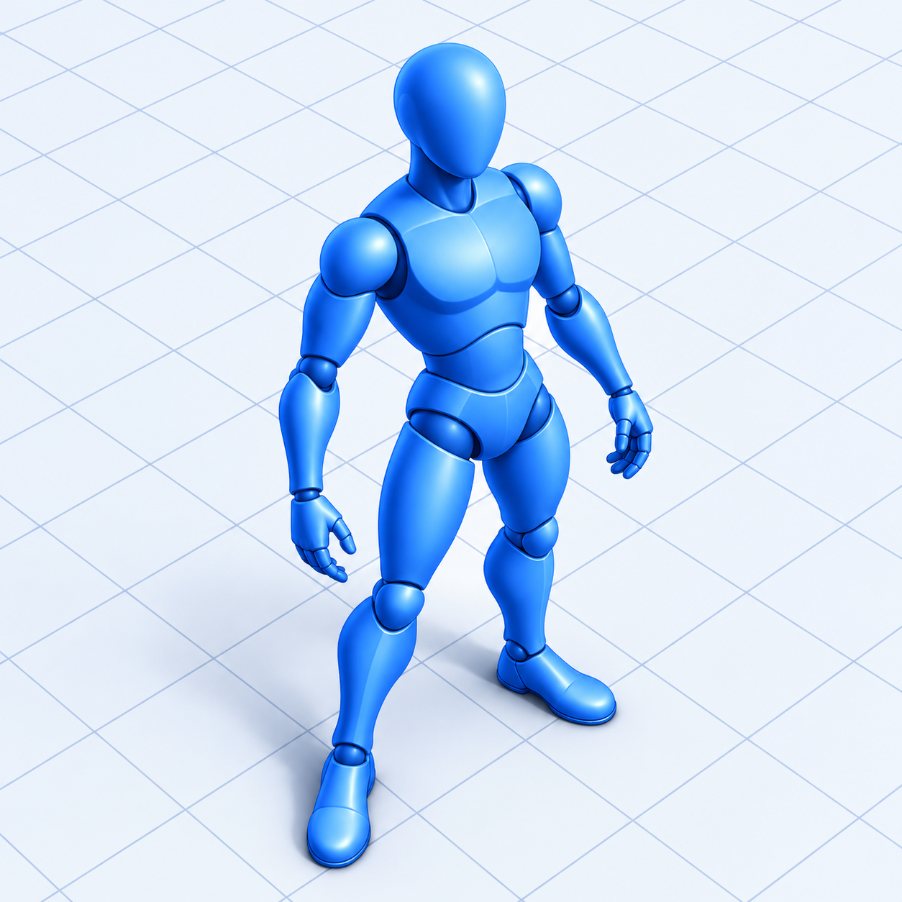

# GoPrevis 0.18.3 — 3D control clips for AI video

GoPrevis prepares 3D control clips for AI video generation. Build the scene, direct character and object motion, frame the camera, and export synchronized color, depth and pose guidance. It uses Godot 4.7.2 .NET, C# and .NET 10. The application UI, dialogs and authored errors are English.

## Run

The Windows portable output is `build/GoPrevis-0.18.3-Windows/GoPrevis.exe`. Keep GoPrevis.exe, GoPrevis.pck and data_GoPrevis_windows_x86_64 together. The portable Windows build includes its runtime; using it does not require the Godot editor or .NET SDK.

For development, open project.godot with Godot 4.7.2 .NET. Local tools are in the ignored .tools directory. The existing run.ps1 starts the source project; build.ps1 -Test builds, runs source checks and exports Windows x64.

## Saving projects

**File → Save project as…** or **Ctrl+Shift+S** saves the current scene under a new name or in another folder and makes that copy active. The picker starts with the current filename and folder. Enter a name; `.goprevis` is appended automatically. Used sources are bundled in the copy's own `.assets` folder. The original project is preserved. **Save / Ctrl+S** writes subsequent changes to the active copy, including after Undo/Redo of edits made before Save As.

The top bar and native window title show the current project name. A new/unsaved scene shows **Untitled**. Hover over the header name for the full path. Long names shorten visually so the toolbar stays compact. Open, Save As, New scene and their applicable Undo/Redo actions update the displayed name.

An **asterisk (*)** beside the project name in the header and native title means the current content has unsaved changes. Successful Save/Save As clears it; Undo back to the saved content clears it too. Playback, scrubbing and navigation in the working view do not mark a project dirty. Changes to the active camera, animation, object/pose data and project settings are included.

Closing the application, opening another project, creating a new scene or opening the demo protects unsaved work with **Save / Discard / Cancel**. Save completes before the requested action; an untitled project first opens Save As. Cancelling that picker or a failed save cancels the pending action. Discard continues without saving; Cancel keeps the current project open. Active AI/export work is cancelled and allowed to restore the working scene before deciding whether it needs saving; completed AI provider work remains in the existing resumable session.

## Removing timeline animation

Click the timeline element to select it, then press **Delete**. Motion clips (human and animal), transform/lens keys, path points, pose-correction keys and camera movement spans are removable. Right-click a clip for its **Delete** action; right-click a key removes the targeted key. Selected animation is visibly highlighted. After deletion the selection clears; another Delete without a selection does not remove another clip or a scene object.

Click a track label and press Delete, or right-click the label, to clear that entire animation track. Expanded Position/Rotation/Scale/Lens and joint rows affect only their own keys. The path span selects the complete path. The camera's whole animation track includes its movement and transform/lens keys. Models and cameras remain in the scene. Each removal is one Undo/Redo action.

Removing a motion preserves the actor's path, transforms and additive pose layer. Removing the last clip clears its fallback source and leaves the figure without source motion; it remains removed after save/reopen. Overlap blending on remaining clips is adjusted to the actual remaining neighbours. The inspector's Remove clip uses the same deletion operation. Text-entry controls keep Delete for editing text.

## AI Director

The default is **GPT-6.1 Sol / High through OpenRouter** (`openai/gpt-6.1-sol`), selected at the user's request. Alternatives remain GPT-6 Luna through OpenRouter or direct OpenAI Responses, native Google Gemini 3.8 Flash, and a custom OpenRouter model supporting tools and images.

Click **AI Director**, choose **New scene** or **Edit current scene**, describe the shot in Czech or English, and click **Build shot** (Ctrl+Enter). **View shot** enters the active camera; Space plays the timeline. A complete request is one Undo action. Subsequent prompts can modify the scene while preserving unrelated animation.

**Image and sketch input:** open **References**, import PNG/JPEG/WebP, or draw on the grid. Choose **Top view**, **Side view** or **Reference**, add notes explaining symbols, scale and object names, then **Add sketch**. Multiple images can accompany one description; **Remove selected** removes an attachment. Top view uses X right / -Z up; side view uses X right / Y up. These images are sent to the selected AI provider. They guide scene construction and are separate from per-camera viewport backgrounds.

**Saved work and Resume:** there is no application-wide token or request-count ceiling. The former 12-request / 45000-output-token / 180000-scene-character guards are removed. Paid responses, completed tools, staged scene sections, input images, usage and the starting scene are checkpointed locally. **Cancel** pauses; **Resume** continues the same saved request, including after an app restart. Resume restores its starting scene when needed, retaining your current scene in Undo. It reuses received provider work; later model requests still incur normal charges. Provider context and per-response limits still apply. Known model output capacity is requested; a provider-truncated response is saved and the director continues with smaller sections. Usage and draft counts remain visible while working or paused. The actual project capacity remains 500 objects and 100 cameras.

The model reads **get_program_guide**, searches real library IDs and measures prepared geometry through **get_asset_details**. It stages large scenes in sections using stable IDs, inspects the complete proposal, rehearses it in the real application, receives rendered camera and side-view gait filmstrips, and must **assess_preview** before applying the accepted planId. Unreviewed or invalid proposals cannot commit. The rehearsal restores the user's document and history. Actual skeletal feet, hips, toes and face measurements reject backward sliding independently of internal heading metadata. The model can revise and rehearse again. These checks do not guarantee ideal acting, composition or collision-free blocking for every prompt.

Normal human, animal and car travel uses a timed **Path**, tangent orientation and compatible in-place source animation. Semantic review catches keyframed route approximations, disabled path orientation, a forward actor rotated backward, duplicate root/path translation, sparse camera curves and conflicting controllers. Manual body corrections remain an additive layer above blended mocap. Explicit backward/sideways actions remain available. AI can also place static poses on real chair seats, sequence and blend motions, key transforms/lenses, add lights, set scene appearance and project dimensions/FPS. Linked cylinders can attach a leash to an animated human hand and dog bone; they follow the actual evaluated joints without rope physics.

Camera **Orbit** is analytic, with radius, angular sweep, height and timing; a full orbit has no baked position/rotation keys. Camera **Path** controls its own flight. **Animated aim path** independently controls pan/tilt; lens keys remain separate. Select a camera, expand **Camera movement**, and choose **Camera position path** or **Camera aim path** to edit points and arrivals. Smooth authored timing preserves pauses and arrivals while joining velocities continuously. Follow/Look at remains available. The trajectory appears in the viewport and a labeled movement span on the timeline. Shift transforms adjust the complete move. Format **13** adds independent aim paths and linked lines; formats 1–12 remain readable.

Use **Connection…** to connect a provider. On Windows **Use existing VIVIDIA key** reads the authorized Google/OpenRouter Windows Credential Manager entries without modifying or copying them. Manual Windows keys use GoPrevis's own OS entry; macOS/Linux manual keys are session-only, with provider environment variables available for reconnection. No key is bundled or sent in project files, images or exports. Only nonsecret model/connection-source preferences are saved. The tested delivery is Windows x64.

The model receives scene geometry rather than local source-file paths. It cannot execute scripts, choose arbitrary files, save projects, export files or alter credentials. Runtime failures preserve the scene/history and checkpointed draft. All committed content remains editable.

Sol Standard rates are $2 input / $10 output per million tokens; Luna is $0.10/$0.50. Gemini 3.8 Flash is $0.75/$3.75 through December 31, 2026, then $1.50/$7.50. Caching and OpenRouter account fees affect actual billing. The UI reports provider-supplied usage/cost. See [OpenAI Sol](https://developers.openai.com/api/docs/models/gpt-6.1-sol), [Google pricing](https://ai.google.dev/gemini-api/docs/pricing#gemini-3.8-flash) and your provider records.

**examples/city-street-15s.goprevis** is the actual Sol / High result from the supplied Czech street brief: four road lanes, opposing traffic, parked cars, pedestrians with walking dogs and connected leashes, trees and shop fronts. The camera pans, rises, crosses the street, descends beside the shop wall and finishes on the stationary couple's faces. Position path, aim path and framing remain editable. **Open city street demo.cmd** opens it directly; **city-street-preview.mp4** shows the complete shot. The director revised tree occlusion, storefronts and final framing through several real rendered previews. This run used 28 provider requests, 47526 output tokens and provider-reported usage of $0.9051937. Opening or playing the example makes no API call.

**examples/ai-smooth-orbit.goprevis** contains a real Sol / High directed curved walk and analytic camera orbit. Input/reference examples and actual model/render validation accompany the portable delivery.

## Editor improvements in 0.15.0

- **Save:** enter only a project name. `.goprevis` is appended automatically, including names such as `Shot 01.v2`. Explicit `.goprevis` names are not doubled; existing `.previs` projects remain supported.
- **Timeline selection:** drag a rectangle from empty track space to select keys across objects, cameras, paths, lens and additive pose tracks. Ctrl/Shift adds another region; Ctrl-click toggles a key. Expanded parameter rows select only their own XYZ key. **Delete** removes the selected keys in one Undo step. Drag the time ruler or the scrub slider to scrub; clip bodies and trim handles keep their existing behavior. Deleting a path diamond removes its waypoint and matching arrival time.
- **Proportional scale:** hold Shift to reveal the transform axes, then hold Ctrl while dragging a scale cube to scale XYZ together. All scale cubes turn yellow while Ctrl is held. Existing nonuniform proportions are retained. Ctrl still snaps move/rotate operations; Alt gives fine adjustment.
- **Lights:** open **Objects → 3D scene → Global lighting**, then choose **+ Point light** or **+ Directional light**. Select the light in the scene list to change **Enabled, Color, Intensity, Range** (point only) and **Cast shadows**. Shift exposes move/rotate controls. Lights are ordinary project objects with transform keys, duplication, Undo/Redo and portable save/reopen. Their handles are editor-only. Real-time shadows appear in the working view, camera preview, RGB frames and RGB video exports. The default scene remains neutral, with no explicit light. Shadows use raster shadow maps; this is not a path-traced renderer.

The portable example **examples/lights.goprevis** contains a box, a point light with shadows and a disabled directional light. Select either light and edit its properties to compare the setup.

Project format **11** stores independently editable lights; project formats **1–10** remain readable. Older app versions reject format 11 rather than reopening a light as a box.

AI Director is available in GoPrevis. Its typed scene commands and remaining design scope are documented in section 12 of NAVRH-GOPREVIS.md. Requests run only when Build shot is clicked.

## Rename and existing projects

The product and GitHub repository are now **GoPrevis**: [petrsajner/GoPrevis](https://github.com/petrsajner/GoPrevis). The Windows executable is **GoPrevis.exe**; the C# solution, assembly and source namespace use the same name. The app UI remains entirely English.

New projects use **.goprevis**. Existing **.genprevis** and **.previs** files, including source asset folders, still open directly. On the first regular start, GoPrevis imports saved user poses and file-picker preferences from the previous **GenPrevis** user profile (falling back to Previs). Existing GoPrevis files are kept, the source profile is untouched, and a one-time marker prevents re-importing deliberately deleted presets. Bundled source caches are recreated on demand.

The approved Windows icon is a blue shaded 3D mannequin on a light perspective grid floor, viewed obliquely from above. The PNG source and multi-size ICO are in `assets/goprevis.png` and `assets/goprevis.ico`.

## Repaired animal feet and motion placement

The twelve Quaternius rigs expose four complete foot chains. Their skin-weighted `IKFrontLeg` / `IKBackLeg` and toe bones are treated as real deforming joints and connected to the corresponding lower legs at runtime. Original authored animation transforms are converted into that hierarchy before blending; source GLB files remain unchanged. The pose inspector labels these joints as Front/Back foot and toes. Moving a knee or ankle carries its descendants and the actual paw mesh.

A newly placed animal's automatic Idle is a replaceable placeholder. The first library motion replaces it. A looping native walk/run fills the remaining shot (at least three seconds); the original short cycle is repeated rather than frozen after one jump. Explicitly authored clips still append and crossfade, and one-shot actions keep their original duration. Clip timing, source IN/OUT and Loop remain editable.

## Ready-made car shot

Double-click **Open car chase demo.cmd** beside GoPrevis.exe, or choose **File → Open car chase demo**. The example opens at frame zero in its following camera. Press **Space** to play. Saving prompts for your own project, preserving the supplied example.

The self-contained **examples/car-chase.goprevis** shot is 12 seconds at 25 fps: a parked blue car accelerates, follows a sweeping 90-degree road turn, decelerates and holds still with the camera for the final two seconds. **Car follow** uses live Follow + Look at bindings to the car, with no baked position/rotation keys; **Wide overview** shows the complete route. Select the car's Path track to inspect arrival keys and Bezier acceleration/deceleration. Changing the car’s path, arrival timing or manual transforms updates the following camera automatically. Every scene object is a built-in prop, so the project needs no imported model or motion file.

## One placement workflow

**Arrange** combines selection and movement. Click an object or camera, then drag its visible body or selection box across the horizontal plane at its current height. Ordinary dragging preserves its Y position. Hold **Shift** to use the complete XYZ transform gizmo: arrows move, cubes scale and rings rotate. There is no separate Select/Move workflow. Free vertical and spatial adjustments are available through the Shift handles. Each continuous drag is one Undo/Redo action.

Use **Pose** on a selected human or rigged animal to edit its body at the playhead. The inspector shows the current task and a back control rather than separate Object/Motion/Path/Pose tabs. Selecting a clip, path key, camera or figure opens the relevant context.

The left library has exactly five sections:

| Library | Visible groups and purpose |
| --- | --- |
| Models | People and Animals in one scrollable library |
| Objects | Furniture, Vehicles, Architecture, Nature and Props |
| Poses | Human poses arranged by posture and activity |
| Motions | Prepared human and animal motion clips |
| Cameras | Scene cameras, framing choices and camera movement presets |

The SCENE object list remains available below the library; Scene is no longer a separate library tab. Models and Objects use visible group headings, category filters and search. Camera moves live with Cameras.

Drag a model or object into the scene, adjust it with Arrange, and drag a compatible motion onto a figure when animation is needed. Dropping a motion onto empty space creates its matching figure. The application remains entirely English.

Object **Transform** tracks remain collapsed by default. Expand one to see grouped XYZ **Position, Rotation and Scale**; cameras also expose **Focal length**. Outside Pose mode, **K** or **Key transform** captures object transforms. Drag timeline diamonds to retime them or right-click to remove them.

## Project setup and camera references

Use the **Project** button in the header to open **Project setup**. Aspect presets include **16:9, 9:16, 1:1, 4:3, 3:2 and 2.39:1**, with custom even pixel dimensions from 64 to 8192. Choose **12, 15, 24, 25, 30, 48, 50 or 60 fps**, or a custom whole rate from 1 to 120. The timeline fps control remains available and edits the same project frame rate. Frame times and key snapping follow it; changing fps preserves keys in seconds.

The camera preview, main **Camera view** gate, camera-frustum drawings and framing presets use the selected aspect ratio. Clean still output uses the project dimensions; whole-shot export starts with that size and fps. Half/double export sizes retain the project ratio.

**Camera background…** below the camera preview opens the active camera’s reference controls, even while a scene object is selected. Alternatively select a camera in **SCENE**, expand **Camera background** near the top of Properties and choose **Load image / video…**. Each camera stores its own image/video, opacity, Fit / Fill cropping, visibility and video time offset. Switching cameras shows that camera’s guide; duplication copies independent settings. The section starts collapsed so transforms stay accessible. It appears behind 3D objects in camera views only. The working perspective remains unchanged. Video is muted and seeks to scene time, including reverse scrubbing; its last frame holds beyond the end. Playback uses one persistent CPU FFmpeg raw-RGB stream with asynchronous prefetch, rather than starting a process and decoding a PNG for every frame. The editor preview is limited to a 960-pixel long edge; original media remains unchanged. A sliding raw-frame cache has a 48 MiB budget per source, retaining at most two sources for camera switching. Cached scrubbing is immediate; an uncached seek may briefly wait for the matching frame. Ordinary playback has been verified with real 1080p H.264 at 25 and 30 fps through the application viewport. Reference pixels are never included in clean stills, MP4, PNG sequences, depth or pose passes.

The **Load image / video…** picker remembers its last browsed folder across cameras and application restarts, including a folder visited before cancelling. This is a local application preference, independent of scene Undo and project files.

## Live camera Follow and Look at

Select a camera in **SCENE** and expand **Follow / Look at** near the top of Properties. The section opens automatically for an already constrained camera.

- **Follow** controls position. Choose its target and adjust **Side**, **Height** and **Distance** in metres. Positive target-relative distance sits behind the target; negative distance puts the camera in front.
- **Look at** controls orientation. Choose the same or a different object, set an XYZ **Aim offset**, and adjust its own smoothness.
- **Target-relative offsets** rotate with the target’s heading. Disable this for fixed world-axis offsets.
- **Smoothness** is a lag in seconds: zero follows exactly; higher values ease the response. It is evaluated from absolute shot time, so scrubbing backward and exporting produce the same camera pose.
- **Match current view** derives offsets from the working camera. Ordinary camera XYZ, gizmo and pilot edits adjust live offsets or an angle correction. **Reset angle** removes the manual orientation correction.

Target paths, source motion and final manual transforms are evaluated before camera constraints. Editing a car path immediately updates its camera without generating new keys. The preview identifies **Follow**, **Look at** or both. Existing absolute camera keys are retained and resume when their corresponding constraint is disabled. Controlled key buttons are disabled with an explanation. A deleted target safely falls back to the source camera animation; Undo restores the binding. Choosing a framing or movement preset releases live constraints so the preset takes effect, with Undo support.

## Object paths and key timing

Select any object, including a car or static prop, and choose **Draw path**. Click points and finish with Enter / **Finish**. Its path has arrival-time diamonds on the timeline; drag them to adjust travel timing. Key **Position, Rotation and Scale** using the inspector diamonds or K, then change frame and edit again. Manual corrections remain above path motion, so a turn or height adjustment can be combined with driving along the curve.

Click a timeline diamond to open its **Interpolation** controls. Timing is attached to the selected key and affects the interval to the next key:

| Mode | Behavior |
| --- | --- |
| Linear | Constant interpolation rate |
| Ease in/out | Smooth acceleration and deceleration |
| Curved | Editable Bezier timing graph; drag its two handles |
| Stop | Zero speed and acceleration at both ends |
| Hold | Keep the current value until the next key, then jump |

The same timing data applies to object/camera transforms, camera lens keys, path arrivals and manual pose-correction keys. Group keys change all channels keyed at that time. Each curve-handle gesture is one Undo action. Timing controls stay hidden until a key is selected.

## Animal pose adjustments

Select a rigged animal and choose **Pose** or **Edit body pose**. The existing joint selector, Move / Rotate tools, Shift alternate tool and viewport handles work on its native skeleton. Moving a joint solves its ancestor chain with IK; descendants follow it. Root movement translates the skeleton. Rotation edits preserve the joint hierarchy. Head, spine, tail and limbs remain on the animal's own rig.

Edits create additive correction keys above the blended native clips. Expand **Pose corrections** on the timeline to inspect and retime keyed joints. **Save to My poses** captures a reusable static pose for that exact prepared animal model; dropping it on empty ground creates that model. Incompatible rigs reject the drop. Applying a stored pose replaces source clips, while entering the editor or saving a pose keeps them. Native IK preserves rig segment lengths but does not impose veterinary joint limits or automatically pin all four feet.

## Model and motion libraries

The library contains **284 ready-to-place model entries**: 255 new props, 12 new rigged animals, the original animated Fox, six prepared human mannequin variants and ten original procedural blockout models. The new props are organized as follows:

| Category | Models |
| --- | ---: |
| Furniture | 71 |
| Vehicles | 20 |
| Architecture | 63 |
| Nature | 55 |
| Props | 46 |

The new animals are Alpaca, Bull, Cow, Deer, Donkey, Fox, Horse, White Horse, Husky, Shiba Inu, Stag and Wolf. The selection includes breed and color variants. Models are bundled locally and use placement scales appropriate for a metre-based scene.

**Motions has 457 cards**:

| Prepared actors | Cards | Content |
| --- | ---: | --- |
| Human | 302 | 300 newly bundled recorded CMU takes, plus the existing synthetic test and captured-walk sample cards |
| New animals | 152 | Quaternius native skeletal animation cycles |
| Original Fox | 3 | Walk, Run and Look around (native Survey) |

The 300 newly bundled CMU takes provide approximately **85 minutes of recorded human motion**, including locomotion, sports, interactions, actions, dance, climbing, everyday activities, sitting and gestures. The 152 new animal clips are **authored animation cycles, not recorded mocap**.

Use visible library groups, category filters and search to narrow the library. Long grouped lists scroll; motion/pose card pages remain bounded for performance. PNG covers show the actual models or sampled poses; animated hover previews initialize lazily. Drag an animal into the scene, or drop one of its motion cards onto empty ground to create the matching actor. Human motions apply to the prepared human rig; native animal cards apply to their matching prepared actor family. An incompatible drop does not retarget between species or unrelated rigs.

Import a personal BVH through **File → Import motion…** or the import action in Motions. Supported humanoid names include standard Mixamo/CMU-style skeletons. Bundled CMU sources use 0.055 metres per source unit; the synthetic source uses 0.01. Source scale is editable per clip.

The CMU cards use a source offset that skips the conversion's first calibration T-pose without modifying the BVH files. Their displayed duration excludes that frame, and **Loop source defaults to off** because recorded takes are not guaranteed to loop seamlessly. Several takes contain multiple actions; trim the desired section on the timeline.

Sources, licenses and preparation notes are in [LICENSES/PROP-CONTENT.md](LICENSES/PROP-CONTENT.md), [LICENSES/ANIMAL-CONTENT.md](LICENSES/ANIMAL-CONTENT.md) and [LICENSES/CMU-MOTION-CONTENT.md](LICENSES/CMU-MOTION-CONTENT.md). The original Fox has separate attributions in [LICENSES/Fox-NOTICE.md](LICENSES/Fox-NOTICE.md); the original walk sample is documented in [samples/real/SOURCE-AND-LICENSE.md](samples/real/SOURCE-AND-LICENSE.md).

## Scene display and object appearance

Open **Objects → 3D scene** for scene-wide settings. Its existing scrollable library contains the collapsible **Background**, **Global lighting** and **Display** groups; no additional library tab is needed.

- **Background → Color** changes the working-view and rendered-shot background.
- **Global lighting → Brightness** adjusts the neutral hemisphere fill from 0–400%. The default is 100%; a directional light remains optional.
- **Display → Ground** controls visibility, **Height** sets the ground plane in metres, and **Opacity** adjusts its display opacity. The editor grid follows the same height and visibility.
- **Object labels** is the global label switch. A selected object or camera also has its own **Show label** switch in Properties. Names update after renaming and remain excluded from PNG/MP4, depth and pose renders.

A selected object has a **Material** section with a color picker, RGB hex entry and a small swatch palette. The sketch-color override affects that instance's rendered materials; **Original materials** restores its authored palette. Model geometry, rigging and source files are preserved. Scene display, per-object colors and label switches are saved in the project and participate in Undo/Redo.

### Place on a support surface

**Place on ground** moves the selected object's currently evaluated lower bounds to the configured Ground height, including a posed or animated figure at the playhead. It works with the configured height even when the ground display is hidden.

**Place on object** enters a one-click placement operation: click an upward-facing supporting surface in the scene; Esc cancels. It uses the target's real mesh surface rather than the top of a broad object box. For a seated human, the support reference is the pelvis/thigh contact area, so the figure sits on the seat instead of placing its feet on it. Other poses and objects use their lower bounds.

Placement translates the object and preserves its orientation, body pose, source clips and pose corrections. Existing transform keys/Auto key are respected at the playhead. It does not reshape a body or run an automatic contact/foot-locking solver; use Pose to adjust individual limbs after placing the figure.

## Static poses

**Poses** contains **118 ready-made human body poses** in nine categories: standing and gestures, chair and floor sitting, kneeling, crouching, lying down and action/interaction positions. Search by name or category and drag a pose onto a prepared human figure. Dropping a pose onto empty ground creates a posed average-adult figure there. The other human body variants retain their proportions when a pose is applied.

A posed figure holds its shape for the entire scene without a motion clip. Applying a library pose deliberately replaces that figure's current source clips and clears its correction tracks; Undo restores the previous state. Entering the Pose editor itself preserves source clips. Position, Rotation, Scale, drawn paths and their manual correction keys remain available above the body pose.

The Poses library can also **save the current body pose** from a selected figure, including a frame sampled from mocap. Saving a preset leaves the figure's existing animation intact. The saved preset can then be applied to another figure as a static pose. Custom presets are stored locally, and a project's applied body pose is embedded in the `.previs` file, so opening a static figure does not require its original motion source or the creator's preset library. **Reset pose** in the library restores the default standing body; if source clips are present, they continue playing.

The self-contained `samples/static-poses.goprevis` example includes a seated figure and chair, floor sitting, kneeling and lying figures. It contains no motion clips or external asset dependencies.

Seating presets are prepared around practical blocking proportions. Match the figure's placement to the actual chair, stool or floor; smaller body variants scale the pose as well. Use Place on object to position a seated pose on the chosen support, then use the manual pose editor below to adjust individual limbs. Existing animal animations retain their own rig compatibility.

## Keyed body corrections above motion

Select a prepared human and choose **Pose** in the viewport toolbar, or **Edit body pose** in its properties. Existing mocap clips, offsets, blends and speed stay active. Entering the editor does not freeze or replace the animation.

Grab a hand or foot and drag to solve its connected limb. Drag the head or another joint to rotate it. Hold **Shift before grabbing** to temporarily exchange Move and Rotate: hands/feet can rotate at the wrist/ankle, and intermediate joints can move. **W/E** choose Move/Rotate explicitly. The operation is latched at mouse-down until release. **Alt** gives a finer drag; **Ctrl** snaps. Precise values are available in a collapsed section.

Dragging an elbow runs IK **upward** through its shoulder chain. The forearm and hand retain their local poses and follow the elbow; they are not held at their old world positions. A moved knee similarly turns the hip connection and carries its shin and foot with it while the pelvis remains stable. Bone lengths remain fixed. When moving the pelvis itself, **Keep feet in place** can pin both feet within the legs' reachable range.

**Every body edit writes correction keys at the current playhead.** Move to a later frame and turn the head or lift an arm to animate that correction over the continuing source motion. A first edit later in the shot adds an identity correction at time zero, so the source starts unchanged and transitions into the edited pose. Rotation corrections use normalized local quaternions; root/pelvis corrections use local XYZ offsets.

**Key joint** captures the selected joint correction. **Key pose**, or **K while posing**, captures the current pose corrections. On the timeline, expand the figure's **Pose corrections** group to see its keyed joints and root offset. Each joint diamond stores the local rotation together; the root diamond stores XYZ together. Drag diamonds to retime; right-click removes a key. These corrections are separate from motion clips and object Transform keys.

The blend order is **blended mocap or static base → local pose corrections → path and final object transforms**. Path heading is derived from the uncorrected blended source, so a keyed manual pelvis turn remains visible rather than being cancelled by path alignment. Scrubbing and reverse playback reevaluate from the source rather than accumulating earlier corrections.

Enter a name and use **Save to My poses** to store the currently visible corrected body as a reusable static library item. Saving does not replace the scene's mocap. The preset retains intentional body offsets and local joint rotations, while separate scene-object placement and proportions remain with the target figure. **Reset edits** restores the correction layer from the start of the editing session; **Done** leaves its keys active.

`samples/manual-adjusted-pose.goprevis` contains a fitted figure and imported chair. For a specific seat, use Place on object or Arrange, then adjust pelvis and limbs in Pose. Placement preserves the body pose; animation foot-contact solving is not provided.

## Arrange motion, paths and corrections

The evaluation order is fixed:

**Blend source motion → apply keyed body-pose corrections → apply path travel/orientation and final object transform corrections.**

Mocap or native skeletal sources blend before the final object transform. Path heading is derived from the final blended pose. Static manual rotation and animated rotation corrections remain additive while the actor follows a path, including throughout a crossfade. Path translation is applied once: horizontal source root displacement is suppressed for supported path-driven tracks.

### Clips

Click a motion clip to open Motion. Drag its body to move it. Drag the **left edge to trim IN**, or the **right edge to trim OUT**. Trimming IN advances the source offset by the removed timeline interval multiplied by clip Speed, while retaining both its timeline OUT and source OUT. Extending the left edge stops at source time zero; IN cannot cross OUT or leave less than one scene frame. Moving the clip body leaves its source IN unchanged. Selected trim handles remain available through an overlapping crossfade. Hover a handle to see its source IN/OUT times. Overlap neighbouring clips to crossfade. Start, Duration, Source offset, Blend in, Speed, Loop source and In-place clip are available for detailed editing. Prepared animals' native clips can also be sequenced and blended within their compatible family. Scene duration can be extended to **600 seconds**.

### Paths

Select an actor, click **Draw path**, then place ground points. **Finish** or Enter applies the curve; Esc restores the previous path. Ctrl snaps points to 0.25 metres. The separate **actor · Path** row shows P1/P2/P3… keys. Drag a key to change arrival time at that point, or edit Arrival time in Path. Path start shifts all arrivals; Travel time rescales them.

Face travel direction can stay enabled while manual Rotation offsets or keys add a turn above the path. With a path enabled, Object Position values are corrections above its evaluated position. They **do not move the curve geometry**. Use Draw / replace to redraw the curve.

## Cameras use the same controls

Camera A/B/C appear in the SCENE list and can be picked through their visible bodies or helper lines. Arrange selects and drags cameras horizontally at their current height, using the same placement interaction as other objects. Hold Shift for constrained XYZ movement, scale and rotation. Existing camera animation channels remain editable.

The **Cameras** library contains the camera list, framing presets and camera movement presets together. **Camera view** pilots the active shot; the project aspect-ratio guide matches the preview. Position, Rotation, Scale and Lens are keyable. **Preview** can hide the small shot view to provide more inspector space.

### Camera framing presets

The **Cameras** library now begins with **15 illustrated framing cards** and retains all 24 movement cards below. Use its shared filter/search to browse Framing, Basic movements or Aerial movements.

| Framing family | Presets |
| --- | --- |
| Working view and front | Current view, Front medium, Front close-up, Front wide |
| Side and back | Side follow, Side close, Back medium |
| Elevated and low | Top wide, 45° high angle, Low angle, Low wide, Bird's-eye |
| Over shoulder and roll | Over shoulder left, Over shoulder right, Dutch angle |

Select the subject before choosing a framing card. The camera uses that subject's actual world-space dimensions, pose and facing direction rather than a fixed global scene origin; human head, shoulder and pelvis joints refine its portrait and over-shoulder compositions. Smaller figures receive proportionally fitted distances. The chosen subject is remembered while switching camera cards. If no subject is selected, the active view's nearest aimed-at figure is preferred, then another scene object.

**Current view** copies the working camera's position, angle and field of view. Other cards create a static camera base and replace that camera's existing movement keys; Undo restores them. Wide framings fit the whole subject, medium/close framings intentionally crop to their intended region, and over-shoulder views look past the matching shoulder. **Side follow** is a side composition ready for a following move; the framing card itself does not add an actor-tracking constraint. Framing preserves the subject's motion and pose layers.

### Illustrated camera movement presets

The Cameras library includes **24 movement cards**, grouped into **Basic** and **Aerial**. Each card has an original diagram showing the camera, subject, viewing frustum and movement direction. Static shot, tilt, pan, crane, truck, dolly, lens zoom, handheld, reveal, push-through, whip pan and crash zoom are available alongside orbit, ascending/descending orbit, aerial establishing, dive and pull-away moves.

A movement preset starts from the camera's current composition and focal length and writes editable camera keys from **frame 0 through the scene duration**. Applying one replaces that camera's movement keys; Undo restores the previous movement. Other cameras keep their own animation. When a selected subject is available, it supplies the composition target; the preset does not create an automatic actor-tracking constraint. **Zoom** presets animate the lens, while **Dolly** presets translate the camera. Handheld movement is deterministic so scrubbing and export reproduce it.

## Compact desktop layout

The interface responds to available window space rather than stretching a tablet-sized canvas across the monitor. Side docks and the timeline are resizable. File/Edit menus hold secondary actions, and the Finish control appears only while drawing.

Layout measurements are in **logical UI pixels**. At 2560 × 1440 the checked header is 35 px high, the play button is 31 px, and the 3D viewport is 1967 × 1136 with default docks. OS DPI remains respected; a 3840-pixel physical width at 150% scale corresponds to a 2560-pixel logical width. Growing the window enlarges the work area rather than every button.

## Precise numeric fields

The arrow area of a numeric field is also a vertical scrub control: **click for one small step, or hold and drag up/down**. Up increases the value and down decreases it at a constant sensitivity; horizontal travel does not accelerate it. Typical arrow steps are **0.001 m for position**, **0.1 degrees for rotation**, and **0.001 for scale**. Values remain rounded to that field's step. **Alt** gives a finer drag, and **Escape** cancels the current scrub.

A continuous numeric scrub creates one Undo action. After reaching a minimum or maximum, dragging the other way works immediately; excess mouse travel is not accumulated beyond the bound. Right-clicking the arrow area does not jump to the minimum or maximum. Direct text and expression entry remain available in the main text area.

## Save, reopen and export

Save creates a **version 13 .goprevis** project and neighbouring .assets folder containing used sources. Keep both together when moving a project. It preserves embedded static body poses and keyed additive pose corrections, motion tracks, paths and path keys, final transform channels, camera channels/lenses and live constraints, active camera, scene display settings, per-object colors/labels, lighting, interpolation curves, native poses and project setup. Every camera’s original image/video source is bundled under a separate safe content-addressed filename in the neighbouring assets folder; decoded preview frames are disposable cache data. Version 1/2/3/4/5/6/7/8/9/10/11/12 scenes are accepted on opening. Version 7 projects migrate their former global reference to the saved active camera. Other cameras start without a reference. Legacy .previs projects remain accepted without renaming; their project data and neighbouring assets retain their existing layout. Format 10 introduced repaired native-foot hierarchy snapshots. Format 11 adds independent light objects and their properties; format 12 adds native procedural camera motion; format 13 adds independent camera aim paths and live linked lines. Earlier releases reject newer schemas instead of silently discarding those fields. Overwriting an existing project keeps the previous JSON as .goprevis.bak.

### Export a complete shot

Choose **Export shot** and confirm the active camera shown in the dialog. Export uses the **whole scene range**, sampled from time zero to the end of the shot with an end-exclusive frame interval. For example, an 8-second shot at 24 fps produces 192 frames at times 0 through 7.95833 seconds, and an 8-second video.

Choose **MP4 + PNG sequences**, **MP4 videos**, or **PNG sequences**; use the project resolution or half/double size at the same aspect ratio and choose the frame rate. Project fps is selected initially, including 12/15/24/25/30 fps. Color, Depth and Pose can be selected independently. A uniquely named output folder preserves earlier exports. The export dialog reports progress and offers cancellation. After success, failure or cancellation, the application restores the working time, selection, playback state and original scene materials.

All selected passes use the **same evaluated frame time, active-camera transform and lens**. This includes mocap blends, keyed body corrections, paths, final object transforms, native animation, camera/lens keys and live Follow / Look at evaluation. Editor grid, joint/transform handles, paths, camera helpers and selection outlines are excluded.

| Output | Files and interpretation |
| --- | --- |
| Color | `color/000000.png`… and/or `color.mp4`; the active camera's rendered scene |
| Depth | `depth/000000.png`… and/or `depth.mp4`; actual rendered surface depth, with white at the configured near distance and black at the far distance or background |
| Pose | `pose/000000.png`… and/or `pose.mp4`; colored rig guidance over black, plus per-frame `pose/000000.json`… annotations |
| Manifest | `manifest.json`; camera identity, settings, exact frame times, pass encoding, frame count, completion status and encoded-video metadata |

**Depth** is an equal-channel **RGB8 linear camera-Z** map, rather than radial distance or inverse depth. The configurable Depth range is recorded in metres. Interior surface values follow `gray = clamp((far - cameraZ) / (far - near), 0, 1)`; background is black. The normalization range is separate from the camera clipping planes. PNG is the lossless control-map master; MP4 uses lossy H.264/YUV420 encoding and may change edge colors or depth byte values.

For **Pose**, choose **Human body · COCO-18** for prepared humanoids, or **All scene rigs · humans + animals** to include animals under their actual native bone names and parent topology. Native animals are **not** relabelled as human COCO joints. The mixed rig map is intended for workflows that can interpret its native topology; it is not a standard human OpenPose map. Human nose, eye and ear anchors are geometric proxies derived from the head rig, not captured facial landmarks. Fingers are not supplied. Per-frame JSON records pixel, normalized and world coordinates, camera-axis depth, visibility/confidence and inferred-landmark flags. Occlusion uses the matching depth render with a documented body/quantization tolerance.

MP4-only export removes its temporary PNG cache after encoding but retains pose JSON. PNG-only export creates no MP4 files. Cancellation records a `cancelled` manifest for any completed frames rather than marking an incomplete shot as successful. Encoding uses the separately bundled FFmpeg tools; no system installation or network access is needed during export. The tool provenance and license are recorded in [LICENSES/FFMPEG-NOTICE.md](LICENSES/FFMPEG-NOTICE.md).

The existing **Export frame** action remains available for a clean **PNG at the project resolution from the active camera** with JSON shot data.

## Navigation and lighting

- Arrange: click to select, drag the object or its box while preserving its height. Hold Shift for XYZ move/scale/rotation handles, including height. Ctrl snaps movement.
- RMB orbits; RMB + WASD/QE flies, with Shift for faster travel.
- MMB pans; **Alt + MMB drag zooms** without a mouse wheel. Drag up to move closer and down to move farther away. Wheel zoom also remains available; F frames selection.
- In Pose: **Shift** temporarily swaps Move/Rotate; **W/E** choose Move/Rotate explicitly. **Alt** is fine adjustment.
- Space plays/pauses. K captures pose corrections in Pose mode, or the selected object transform in Arrange.
- Ctrl+S/O saves/opens. Ctrl+D duplicates. Ctrl+Z undoes. Ctrl+Shift+Z or Ctrl+Y redoes. The header also has visible Undo and Redo buttons, disabled when their history is empty. Delete removes selection.
- Draw path uses LMB points, Enter to finish and Esc to cancel.

The scene and library previews use neutral hemisphere illumination, with **no directional light enabled by default**. The Objects library includes a fixed **Studio key light** switch and **+ Point light / + Directional light** controls. The project saves that choice.

## Current limits

- The recorded library is a curated CMU subset, not the complete database. Source quality and take lengths vary; no motion cleanup or seamless looping is implied.
- Humanoid BVH retargeting uses a fixed 21-bone mannequin. There is no universal animal retargeting, finger animation, automatic animation foot-contact/foot-slip solving, collision avoidance or automatic prop-contact solving.
- Match mocap Speed and path arrival times to the intended gait. Keyed path timing does not itself solve foot contacts.
- Imported FBX/GLB/glTF models preserve their own rigs and embedded clips. Native skeletal sequencing works on supported skeletons; library compatibility is restricted to prepared actor families.
- Use self-contained GLB for portable models. External glTF dependencies are not bundled; saving such a model is refused. FBX may require embedded textures.
- The original Dog blockout model remains a static prop. Husky and Shiba Inu are supplied rigged dogs with native animation cycles.
- Camera cuts, audio, video plates, edge/mask passes and direct AI generation are not implemented. The current whole-shot export contains video frames and selected depth/pose guidance; compatibility with an AI model depends on that model's required control format.
- Windows x64 is the verified development platform. macOS/Linux builds have not been verified.

See VALIDATION.md for the exact checks and final delivery status.

© Petr Sajner 2026. The visible header and native file metadata identify the current application version.
