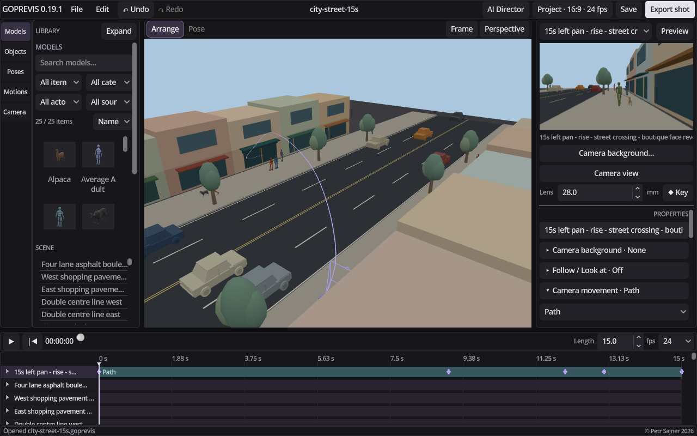
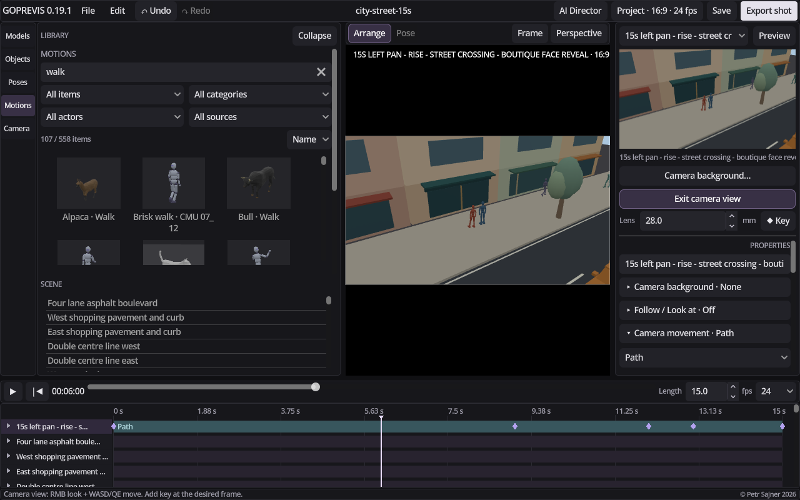
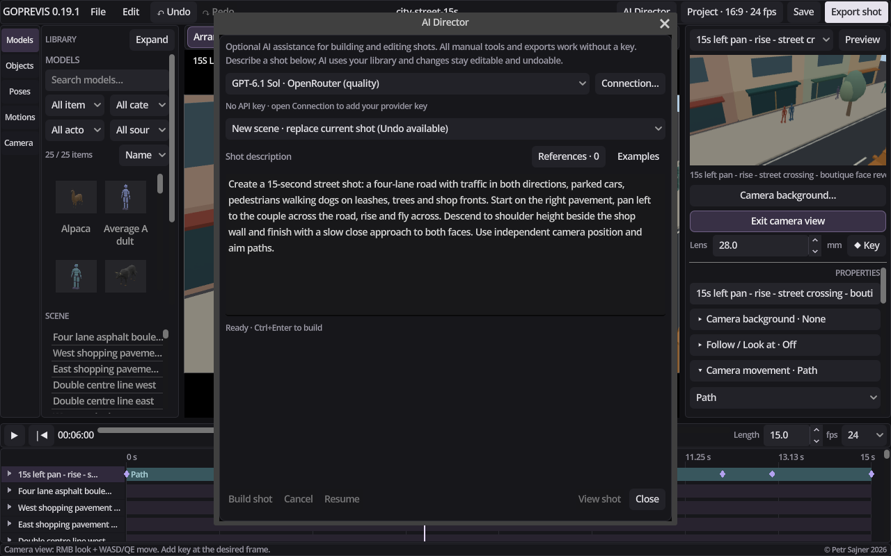

# GoPrevis 0.19.1 Alpha - Fast 3D previs for AI video

Development build **0.21.1** adds independent XYZ property channels, a dope sheet and value/speed graphs, with directly editable property values, grouped key dragging and motion clip Duplicate / Copy / Paste. Recorded motion ranges show unused source data beside the active trim. See the [animation editor guide](docs/ANIMATION-EDITOR.md). The download links below refer to the published release.

**Alpha release - under active development.** Features and workflows are still evolving. Feedback is welcome and will help shape the next versions.

**[Download Windows x64](https://github.com/petrsajner/GoPrevis/releases/download/v0.19.1-alpha/GoPrevis-0.19.1-Windows.zip)** · [English PDF manual](docs/GoPrevis-User-Guide-EN.pdf) · [Watch the street flyover](https://github.com/petrsajner/GoPrevis/releases/download/v0.19.1-alpha/GoPrevis-Street-Flyover.mp4) · [All releases](https://github.com/petrsajner/GoPrevis/releases)

**Build the scene, direct the action and frame the shot.** GoPrevis is a simple, straightforward tool for quickly turning a shot idea into an editable 3D scene and a moving camera view.

Its main purpose is to create **3D guide videos for AI video generation tools**. Plan the composition, spatial relationships, character movement and camera timing, then export guidance that communicates the shot you want to generate.

*The supplied 15-second street example: traffic, pedestrians, dogs, shops and a camera flight across the road. Objects, animation and camera paths remain editable.*

## Build and animate your scene

- **People, animals and props:** arrange prepared characters, rigged animals, vehicles, furniture, buildings and other objects. Import your own GLB, glTF or FBX models.
- **A searchable motion library:** browse 558 human and compatible animal motions, with previews, filters, favorites and collections. Import BVH motion capture, trim clip beginnings and endings, sequence actions and blend transitions.
- **Paths and keyframes:** move a car around a bend or send a character along a curved route. Control arrival times, acceleration and deceleration, with automatic facing along the path and additional manual adjustments.
- **Poses and IK:** start from a ready-made pose, drag hands and feet to fit a chair or an interaction, and save your own poses. Animate head turns and gestures as corrections above existing motion.

*Search the library by action, actor or source, then drag a compatible motion onto a character.*

## Direct the camera and export the shot

Work with multiple cameras, framing presets and illustrated camera moves. Create smooth orbits, give a flying camera its own position and aim paths, or use live **Follow / Look at** to keep tracking a subject after its route changes.

Each camera can have an image or video reference for viewport framing. Choose your aspect ratio, resolution and frame rate, including 12, 15, 24, 25 and 30 fps. Set the scene background, ground, object colors and lighting; add lights and shadows when needed.

Export the active camera's complete shot as **MP4, PNG sequences, or both**, with synchronized **color, depth and pose passes** for your external AI video workflow. Camera reference media and editing overlays stay out of the exported frames.

## Optional AI Director

Describe a complete shot or ask for a specific change. Add reference images or a top/side sketch to explain the layout. **AI Director can arrange the scene, assign motions, create paths and plan camera movement**, then rehearse proposals and inspect rendered previews before applying them.

The result is ordinary editable scene content. You can refine it manually, request another change or undo it.

*AI Director with a prepared street-shot description. The pictured request has not been submitted.*

**GoPrevis works fully without AI.** Scene building, posing, animation, camera work and exports require no API key and incur no AI usage fees. Only the optional AI Director uses your own provider API key and incurs provider charges.

## Built with Godot

GoPrevis is built with **Godot and C#**, using [Godot's support for Windows, macOS and Linux desktop projects](https://docs.godotengine.org/en/stable/tutorials/scripting/c_sharp/c_sharp_basics.html). The current release is built and tested for **Windows x64**. If there is interest, **macOS and Linux versions can be prepared from the same project**.

The Windows package is portable: extract the complete archive, keep its files together and launch **GoPrevis.exe**. You do not need to install the Godot editor or a .NET SDK. The interface is entirely English.

A **41-page English PDF manual** and editable example projects are included, including the street flyover shown above. Opening, playing and manually editing an example makes no AI request.

Follow development and support my tools on [Patreon](https://www.patreon.com/c/PetrSajner). If you would use a macOS or Linux version, let me know.

Copyright Petr Sajner 2026.

## Source and development

The application uses Godot 4.7.2 .NET and .NET 10. See the [technical reference and build instructions](https://github.com/petrsajner/GoPrevis/blob/main/TECHNICAL-REFERENCE.md) for development setup and detailed behaviour.

Third-party engine, runtime and library content retain their respective licenses and credits. See [Third-party notices](THIRD-PARTY-NOTICES.md) and [LICENSES](LICENSES). Human mocap and authored animations are identified separately in the library.
